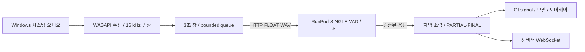

# VOXLUX

**Windows 시스템 오디오를 RunPod GPU 서버에서 한국어로 인식하고, 연속 자막과 데스크톱 오버레이로 표시하는 원격 자막 애플리케이션입니다.**

## 개발 배경

영상·웹 콘텐츠의 시스템 오디오를 읽을 수 있는 자막으로 제공하는 접근성 문제에서 출발했습니다. 이 저장소의 기술적 초점은 모델 호출 자체뿐 아니라, 지속적인 오디오 수집과 느려질 수 있는 원격 추론 사이의 부하 제어, 중첩 인식 결과의 조립, GUI의 상태 수명 관리에 있습니다.

현재 포트폴리오의 범위는 **SINGLE STT**입니다. 원본 mono 오디오 한 스트림을 인식하며 **음원 분리와 화자 분리·식별은 현재 기능에 포함하지 않습니다**. `phase0`~`phase2` 및 일부 `overlap` 경로는 개발 이력·실험 자료로 남아 있습니다. 파일명에 남은 `speaker`·`separation`이 현행 다화자 기능을 의미하지는 않습니다.

## 주요 기능과 화면

- Windows WASAPI Loopback 수집과 48 kHz → 16 kHz 변환
- 3초 윈도우·2초 stride의 원격 VAD/STT 처리
- bounded queue, 오래된 결과 폐기, timeout 및 요청 실패 기록
- 중첩 텍스트 정합, PARTIAL 갱신과 FINAL 수명 관리
- Qt worker 분리, 서버 실패·복구 표시, 자막 오버레이
- RAW STT·자막 이벤트·타이밍 근거 추적, 사람 검수용 정확도 데이터셋


기존 Windows 검증의 **Qt 위젯 렌더링 이미지**입니다. 전체 GUI나 다른 앱과 합성된 데스크톱 캡처는 아닙니다. 당시 인식 오류도 그대로 포함합니다. [이미지 검증 범위](docs/overlay_validation_20261024/README.md)를 함께 확인할 수 있습니다.

## 기술 스택

| 영역 | 기술 및 역할 |
|---|---|
| 클라이언트 | Python, PySide6, SoundCard/WASAPI, NumPy·SciPy·SoundFile |
| 전송 | requests.Session, HTTP/1.1 keep-alive, FLOAT WAV, JSON + float32 binary 응답 |
| GPU 서버 | Python ThreadingHTTPServer, 단일 추론 executor, CUDA·CTranslate2/faster-whisper |
| 음성 처리 | Silero VAD, 기본 `large-v3-turbo`, 한국어 beam 5 |
| 표시·검증 | Qt signal/model/overlay, 선택적 WebSocket, unittest, WAV·JSONL evidence |

## 시스템 아키텍처



Windows는 캡처·시간축·자막 상태를, 서버는 모델과 추론을 담당합니다. GUI는 QThread에서 파이프라인을 실행하고 구조화된 이벤트를 받습니다. 서버는 모델을 유지하고 추론을 직렬화합니다. 이 경계는 GUI에서 모델을 실행하지 않는 배포 구조와, 독립적인 HTTP·자막 회귀 테스트를 가능하게 합니다. HTTP 호출은 전용 worker 안에서 동기 실행되며, 캡처·후처리와의 동시성은 스레드와 bounded queue로 구성합니다.

## 핵심 구현과 문제 해결

| 과제 | 구현 및 검증 포인트 |
|---|---|
| 추론 지연 중 오디오 적체 | 원격 큐 3개, 결과 큐 2개, 기본 6초 age 검사, 서버 active+pending 4개 상한. 합성 지연·STOP·포화 테스트로 검증 |
| 같은 음성이 여러 창에 포함됨 | 인접 창 suffix/prefix 정합과 제한된 fuzzy 교정. FINAL 이력과 confirmed prefix 보호 |
| 무음에서 비정상 텍스트 전달 | VAD=false인데 RAW가 비어 있지 않은 응답 거부. 모델 환각 전체 해결과는 구분 |
| 잘못된 문장 교체 | 정상 두 문장을 지우던 정정 실험을 철회하고 보존 회귀 추가. 조기 FINAL 사례 A/M1은 미해결 |
| 최초 자막 지연의 잘못된 정의 | 창 처리 완료가 아닌 최초 비어 있지 않은 공개 자막 생성 시점으로 계측 수정 |
| 서버 오류가 GUI에 드러나지 않음 | remote 상태 hook → worker → Qt signal로 오류·복구 전달, 이전 worker 이벤트 차단 |

[문제 해결 과정과 커밋 근거](docs/troubleshooting.md)에서 재현·변경·검증·한계를 설명합니다.

## 검증 결과

- 현재 HEAD `5da8925`에서 CPU/HTTP/Qt 회귀 **131개와 직접 실행 스크립트 4개가 통과**했습니다. 범위와 재현 명령은 [성능·검증 문서](docs/performance.md)에 기록했습니다.
- 기존 RTX A5000 실험에서 beam 5 STT 평균 **0.1926초**, p95 **0.2175초**를 기록했습니다. A/B WAV 일부 창의 모델 decode 시간이며 Windows → 원격 서버 → 화면 전체 지연이 아닙니다.
- 사람 검수 대상 24개 클립을 준비했으나 정답은 `pending`입니다. **현재 검증된 CER/WER 또는 정확도 개선율은 제시하지 않습니다.**

## 상세 기술 문서

| 문서 | 내용 |
|---|---|
| [아키텍처](docs/architecture.md) | 실행 경로, 모듈 책임, HTTP 계약, 스레드 경계 |
| [오디오 파이프라인](docs/audio-pipeline.md) | 캡처, 윈도우, 큐, VAD/STT, 오류 처리 |
| [자막 처리](docs/subtitle-processing.md) | 중복 제거, 상태·근거 관리, Qt 전달 |
| [문제 해결](docs/troubleshooting.md) | 실제 결함·실험 철회·남은 문제 |
| [성능과 검증](docs/performance.md) | 측정 조건, 테스트, 정확도 평가와 미검증 항목 |
| [설치와 실행](docs/installation.md) | Windows 클라이언트, RunPod 서버, 연결 진단 |

## 설치·실행 요약

Python 3.10 또는 3.11과 가상환경을 권장합니다. GPU 서버는 드라이버와 호환되는 CUDA PyTorch 런타임이 필요합니다. `requirements.txt`는 torch를 직접 지정하지 않습니다.

서버에서 의존성과 모델을 준비한 후:

```bash
python phase4/gpu_processing_server.py --host 0.0.0.0 --port 8787 \
  --processing-profile single --whisper-model large-v3-turbo
```

Windows PowerShell에서 의존성을 설치하고 서버 URL을 지정한 후:

```powershell
$env:GPU_SERVER_URL = "https://YOUR-SERVER-HOST"
.\.venv\Scripts\python.exe -m phase5.gui_app
```

실제 설치 순서, 모델 다운로드 및 보안 경계는 [설치 문서](docs/installation.md)를 따릅니다. 실행 시 임시 기본 서버 주소에 의존하지 않고 자신의 URL을 명시합니다.

## 한계와 개선 방향

WASAPI 장치별 채널 선택, 실제 네트워크와 화면 반영까지의 지연, 장시간 안정성은 추가 검증이 필요합니다. 큐 포화·age 폐기는 최신성 확보와 음성 손실을 교환하며 무손실 자막을 보장하지 않습니다. A/M1의 조기 FINAL, 일부 source-support 계약과 작은 화면의 줄바꿈 문제도 남아 있습니다.

다음 검증 우선순위는 사람 정답 검수와 RAW/FINAL 분리 평가, 최신 Windows 원음·이벤트·GUI trace의 동시 수집, 문장 정정 근거의 시간 정렬, 실제 전송·화면 지연 측정입니다. 인증·TLS는 서버 애플리케이션에 구현되어 있지 않으므로 외부 노출 시 별도 접근 제어가 필요합니다.
