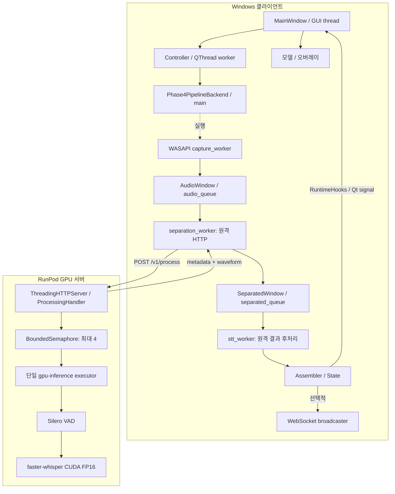

[← README로 돌아가기](../README.md)

# 시스템 아키텍처

## 기준과 기능 경계

분석 기준은 로컬 `work`, HEAD `5da8925b2d5510d79eb62ce1375a9009f473d4e3`입니다. 최초 문서 작성 전 작업 트리는 깨끗했으며, 최종 검토 시작 시에는 기존 README 수정과 상세 문서 신규 파일을 보존한 상태였습니다. 현재 GUI의 원격 **SINGLE** 경로를 설명하며, 음원·화자 분리는 기능 범위 밖입니다. 과거 문서의 두 화자 분리 파이프라인보다 아래 최신 코드가 기준입니다.

`phase3/run_overlap_pipeline.py`와 `SeparatedWindow`, `separation_worker`, 응답의 `speakers` 등에는 과거 이름이 남아 있습니다. SINGLE 서버는 원본 slot 0과 비활성 slot 1을 반환해 기존 계약을 유지합니다. 두 slot이 두 실제 화자를 의미하지 않습니다.

## 책임과 실제 진입점

| 계층 | 코드 | 핵심 책임 |
|---|---|---|
| GUI | [gui_app.py](../phase5/gui_app.py) `MainWindow` | 시작·중지, 상태 표시, 모델과 오버레이 연결 |
| 실행 제어 | [live_caption_controller.py](../phase5/live_caption_controller.py) `LiveCaptionController`, `LiveCaptionWorker` | QThread 수명, cooperative stop, worker 이벤트 격리 |
| 어댑터 | 같은 파일 `Phase4PipelineBackend.preflight/run` | health/profile·Windows 장치 확인, CLI 인자로 파이프라인 호출 |
| 파이프라인 | [run_overlap_pipeline.py](../phase3/run_overlap_pipeline.py) `main` | capture/HTTP/후처리 worker, 큐, 시간축, 통계·evidence |
| 원격 클라이언트 | [remote_gpu_client.py](../phase4/remote_gpu_client.py) `RemoteGPUClient`, `parse_result` | WAV encode, 요청, timeout, 응답 identity·수치 검증 |
| 서버 | [gpu_processing_server.py](../phase4/gpu_processing_server.py) `ProcessingHandler`, `PipelineService` | 입력 검증, admission, 모델 로드·추론·health |
| 응답 codec | [remote_gpu_protocol.py](../phase4/remote_gpu_protocol.py) | JSON metadata와 little-endian float32 waveform의 binary framing |
| 자막 상태 | [subtitle_assembler.py](../phase3/subtitle_assembler.py) | `SubtitleAssembler`, `SpeakerSubtitleState`, 구조화된 이벤트 |
| 표시 | [subtitle_presentation.py](../phase5/subtitle_presentation.py), [subtitle_overlay.py](../phase5/subtitle_overlay.py) | 중복 이벤트 차단, 만료, 시각적 표시 |

`Phase4PipelineBackend.run`은 `--live --processing-mode remote --assemble --speaker-mode single`에 해당하는 인자를 구성합니다. `RuntimeHooks`가 subtitle/metric/remote state를 Qt 계층으로 전달합니다. GUI의 핵심 경로는 콘솔 문자열 파싱이나 WebSocket 수신에 의존하지 않습니다.

## 배치와 데이터 흐름



서버가 자막 history를 소유하지 않고 클라이언트가 순차적으로 조립하므로, HTTP 단위의 추론 결과와 세션 단위 자막 상태를 분리해서 검사할 수 있습니다. 이 설명은 구현 경계의 효과이며 작성자의 미기록 설계 의도를 추정한 것은 아닙니다.

## HTTP 계약

### 상태 확인

`GET /healthz`는 `status`, `gpu_ready`, `models_loaded`, `processing_profile`, `model_status`, `stt_model`, `stt_options`, 모델 로드 시간, 요청 통계와 GPU 메모리를 반환합니다. GUI는 알려진 profile이 SINGLE과 다르면 시작을 거부합니다. legacy 응답에서 profile 필드가 없는 경우는 허용합니다.

### 처리 요청

`POST /v1/process`, `Content-Type: audio/wav`로 finite mono 16 kHz FLOAT WAV를 전송합니다. 상한은 30초 및 16 MiB입니다. FLOAT 포맷은 전송 시 PCM16 양자화·clipping을 피합니다.

| 헤더 | 의미 |
|---|---|
| `X-Request-ID` | 개별 요청 식별자 |
| `X-Window-Index` | 원래 윈도우 인덱스; 실패 후 재번호 부여하지 않음 |
| `X-Capture-Timestamp` | 클라이언트 capture 시각 문자열 |
| `X-Stream-Start-Seconds`, `X-Stream-End-Seconds` | 원음 스트림상의 구간 |
| `Accept` | binary 응답 media type 선택 |
| `X-Latency-Diagnostics: 1` | 선택적인 세부 계측 |

### 처리 응답

응답 metadata의 주요 필드는 다음과 같습니다. 예시는 구조 설명용이며 측정 결과가 아닙니다.

```text
type=processing_result, schema_version=1
request_id, window_index, capture_timestamp, stream_start_seconds, stream_end_seconds
audio: sample_rate, channels, duration_seconds
speakers[0..1]: raw_slot, sample_count, waveform, vad, raw_transcript,
               stt_seconds, stt_diagnostics
timing: queue_wait_seconds, separation_seconds, vad_seconds,
        stt_seconds, processing_seconds, ...
gpu_memory, fp32_fallback, pre_separation_silence
```

기본 클라이언트는 `application/vnd.speech-caption.processing-result.v1+octet-stream`을 요청합니다. `SCP1` magic, network-order metadata 길이, UTF-8 JSON, 이어 붙인 waveform bytes 순서입니다. 각 waveform은 offset/byte_length를 갖는 `binary-f32le`입니다. JSON 호환 경로는 `base64-f32le`입니다. decoder는 길이·magic 등을 검사하고 `parse_result`는 identity, slot 수, 샘플 수, finite 값, VAD·timing을 검증합니다. VAD=false/nonempty RAW는 프로토콜 오류입니다.

SINGLE에서는 slot 0만 VAD/STT 대상으로 사용하며 slot 1은 zero waveform·비활성 VAD·빈 transcript입니다. 이 호환 필드와 `separation_seconds`만 보고 음원 분리를 수행했다고 해석하면 안 됩니다.

오류는 HTTP 상태와 `type=error`, `request_id`, `error.code/message/retryable` envelope로 전달합니다. 잘못된 입력 400, 크기 초과 413, 경로 부재 404, 추론 실패 500, admission 초과 503 `server_busy`를 구분합니다.

## 동시성과 수명

HTTP handler는 요청별 스레드지만 GPU executor는 `max_workers=1`입니다. 모델은 `PipelineService` 초기화 중 `_load_models`에서 한 번 생성합니다. warmup과 후속 요청 추론은 동일한 상주 `gpu-inference` executor 스레드에서 실행합니다. `BoundedSemaphore(4)`로 실행·대기 합계를 제한합니다. 초과 요청을 무한히 executor에 쌓지 않습니다.

클라이언트는 capture, HTTP, 후처리 worker를 큐로 연결합니다. Qt controller의 STOP은 event를 설정하며 이미 실행 중인 HTTP를 강제 취소하지 않습니다. 종료 표식을 전달하고 worker가 종료된 뒤 재시작을 허용합니다. `_forward_subtitle` 및 상태 전달은 현재 worker 여부와 controller 상태를 검사해 이전 세션의 queued signal을 배제합니다.

이 구조는 실시간 마감 보장이나 다중 사용자 추론 서버가 아닙니다. 실패한 창은 누락될 수 있고, timeout 이후 서버 작업이 남을 수 있습니다. 상세 정책은 [오디오 파이프라인](audio-pipeline.md), 표시 수명은 [자막 처리](subtitle-processing.md)를 참조합니다.
