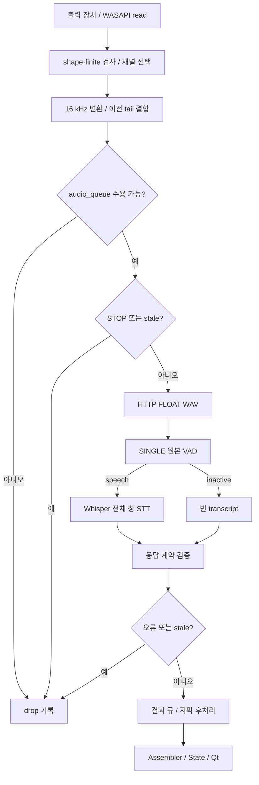

[← README로 돌아가기](../README.md)

# 오디오 수집과 원격 STT 파이프라인

## 범위와 진입점

현재 GUI가 호출하는 `Phase4PipelineBackend.run` → [run_overlap_pipeline.py](../phase3/run_overlap_pipeline.py)의 remote/SINGLE 경로를 기준으로 합니다. 서버의 음원 분리와 화자 분리는 사용하지 않습니다. 역사적인 worker·자료형 이름은 유지되어 있어 이름과 실행 분기를 함께 읽어야 합니다.

## 1. WASAPI Loopback과 채널

GUI의 `preflight`는 health/profile 확인 후 Windows 여부를 검사하고, [audio_devices.py](../phase3/audio_devices.py)의 `resolve_output_speaker`, `get_loopback_microphone`으로 선택한 출력 장치의 loopback을 얻습니다. 장치 이름 문자열만 저장하지 않고 출력 장치 ID를 실행에 전달하는 경로가 있습니다.

`capture_worker`는 `loopback.recorder(samplerate=base.CAPTURE_SAMPLE_RATE)`를 열어 48 kHz 오디오를 읽습니다. 반환 배열의 frame 수·채널 수·finite 여부를 검사합니다. [audio_diagnostics.py](../phase3/audio_diagnostics.py)의 `select_capture_channel`과 `capture_audio_diagnostics`가 채널 선택 및 신호 상태 기록을 담당합니다.

기본 `first`는 첫 채널을 선택합니다. `mean`은 명시적으로 선택하는 비교 옵션입니다. 모든 장치에서 첫 채널이 적합하다는 검증은 없습니다. 오른쪽 채널에만 신호가 있거나 평균에서 위상 상쇄가 발생하는 경우를 구분해야 합니다. 서버 장애와 캡처 무음을 같은 문제로 취급하지 않습니다.

## 2. 리샘플링과 sliding buffer

[phase1/capture.py](../phase1/capture.py)의 `_resample`을 공용 경로에서 사용하며 SciPy `resample_poly`로 16 kHz mono float32를 만듭니다. 이 표본률이 서버 WAV·VAD·STT의 입력 기준입니다.

| 항목 | 기본값 | 결과 |
|---|---:|---|
| capture sample rate | 48,000 Hz | 장치에서 읽는 원본 블록 |
| processing sample rate | 16,000 Hz | 서버 요청 및 원음 증거 |
| window | 3초 | 48,000 samples |
| stride | 2초 | 새로 읽는 32,000 samples |
| overlap | 1초 | 이전 tail 16,000 samples 재사용 |

첫 창은 3초를 읽고, 이후에는 2초를 읽어 이전 1초 tail과 결합합니다. `AudioWindow`는 index, waveform, stream start/end, capture 시각 및 latency 정보를 보유합니다. 윈도우 i는 `[2i, 2i+3)`초이며, 스트림 위치와 처리 완료 시각은 서로 다른 값입니다. 기본 첫 자막은 최소한 첫 창 수집의 영향을 받으므로 STT decode 시간만큼 빨리 표시되는 구조가 아닙니다.

## 3. 큐와 백프레셔

`WindowQueue`는 삽입 시점 계측을 lock 안에서 확정한 뒤 소비자에게 공개합니다. 계측 timestamp를 enqueue 후에 기록하면 소비자가 먼저 접근할 수 있었던 경쟁 조건의 수정입니다.

| 경계 | 기본 용량 | 포화 정책 |
|---|---:|---|
| remote `audio_queue` | 3개 | 신규 창 drop |
| `separated_queue` | 2개 | 신규 결과 drop |
| 선택적 subtitle event queue | 32개 | broadcaster의 oldest drop |
| 서버 active+pending | 4개 | 초과 HTTP 503 |

수집 worker가 HTTP 응답을 기다리며 오디오를 읽지 못하는 것을 피하지만, 무손실을 보장하지 않습니다. 평균 처리 속도가 stride보다 느리면 큐가 차고 음성이 누락됩니다. 용량 증설만으로 오래된 자막 문제를 해결할 수 없습니다.

remote live에서는 capture 완료 후 `audio_queue_maxsize × stride`보다 오래된 창을 요청 전, 응답 후, 결과 소비 시 검사·폐기합니다. 기본 예산은 6초입니다. 이는 실측 SLA가 아니라 큐·stride로 정한 freshness 정책입니다. 처리 중 요청을 6초에 강제 취소하거나 표시 지연을 6초 내 보장하지는 않습니다. offline reference 경로와도 구분됩니다.

## 4. 원격 전송과 결과 처리

`separation_worker`가 `RemoteGPUClient.process`로 전체 창 FLOAT WAV를 전송합니다. worker 이름과 달리 SINGLE 서버에서 separator는 실행하지 않습니다. `requests.Session`과 pool size 1, keep-alive로 연결을 관리하며 자동 retry는 없습니다. HTTP 호출 자체는 동기식이며 capture/후처리와는 별도 스레드로 실행됩니다. `session.trust_env=False`이므로 환경변수 프록시를 자동 사용하지 않습니다.

서버의 `PipelineService._process_serialized`는 원본을 slot 0으로 놓습니다. [validate_end_to_end_gpu.py](../phase3/validate_end_to_end_gpu.py)의 `detect_speech_activity`로 Silero VAD를 실행하고 기본 minimum speech 200 ms를 사용합니다. VAD가 음성으로 판정한 경우 **창 전체**를 `transcribe_base`에 전달합니다. VAD timestamps로 잘라 이어 붙이는 구조가 아닙니다. slot 1은 비활성 호환 데이터입니다.

[faster-whisper 호출](../phase3/stt_context.py)의 명시적 옵션은 `language=ko`, `beam_size=5`, `condition_on_previous_text=False`입니다. 기본 모델은 `large-v3-turbo`, CUDA `float16`입니다. `transcribe_base`라는 함수명이 base 모델 고정을 의미하지 않습니다. lazy segment generator를 `list`로 소비하는 시간까지 측정합니다. confidence 계열 통계는 진단 근거이며 정답 확률이 아닙니다.

클라이언트는 응답을 검증해 `SeparatedWindow.remote_result`와 함께 결과 큐로 넘깁니다. 이후 `stt_worker`는 서버가 반환한 VAD/transcript를 사용해 자막 후처리를 수행하며 로컬 STT를 다시 실행하지 않습니다.

## 5. 오류·timeout·중지

- connect/read timeout 기본값은 5/30초입니다. read timeout은 요청 전체의 절대 deadline이 아닙니다.
- 연결·timeout·HTTP·protocol 오류는 `RemoteGPUError` 계열로 분류됩니다. 실패한 창을 기록하고 다음 창을 계속 처리합니다. 같은 창 재시도나 로컬 모델 fallback은 없습니다.
- window index를 재부여하지 않아 gap을 자막 근거 계산에서 식별할 수 있습니다. gap을 인접 관측으로 간주해 중복을 제거하지 않습니다.
- remote state hook으로 오류와 다음 정상 응답의 복구를 GUI에 전달합니다. 복구가 앞서 누락된 음성을 되돌리지는 않습니다.
- STOP 후 대기 창과 늦은 응답을 폐기하고 종료 표식을 전달합니다. 진행 중 HTTP와 WASAPI read는 cooperative 종료 범위 밖에서 즉시 취소되지 않습니다.
- `drop_details`, `remote_failures`, session/window/request ID가 사유·단계·나이를 추적합니다. 사용자 취소와 오류 종료를 구분합니다.

## 실제 흐름

## 검증과 관측의 경계

[원격 worker 테스트](../phase4/test_remote_overlap_pipeline.py)는 실제 worker 연결을 모의 capture/model과 함께 실행해 STOP, 큐 포화, 지연 응답, 실패 뒤 계속 처리와 최초 공개 자막 계측을 검사합니다. [클라이언트 테스트](../phase4/test_remote_gpu_client.py)는 localhost HTTP timeout·재연결·계약을 검사합니다. 이것은 실제 WASAPI 장치나 RunPod proxy 지연 검증이 아닙니다.

클라이언트와 서버 각 호스트의 `perf_counter` duration만 비교합니다. 두 호스트 절대 단조 시각을 서로 빼지 않습니다. HTTP RTT에서 서버 시간을 뺀 잔차는 직렬화·업로드·다운로드·proxy 등을 포함하며 순수 네트워크 시간으로 단정할 수 없습니다.
