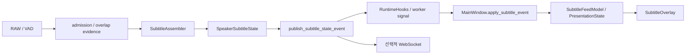

[← README로 돌아가기](../README.md)

# 연속 자막 조립과 표시 수명

## 문제: 중첩 오디오와 변하는 인식 가설

3초 창을 2초 간격으로 처리하면 1초의 오디오가 다음 창에도 포함됩니다. RAW STT를 매번 append하면 중복되고, 같은 글자라는 이유만으로 모두 삭제하면 의도적인 반복 발화가 사라집니다. 후속 창에서 조사·어미·문장부호가 바뀌는 경우에는 단순 exact match도 충분하지 않습니다.

현행 SINGLE 경로는 한 스트림의 연속 인식 가설을 조립합니다. 코드의 `speaker=0`, `speaker_0`는 기존 이벤트 계약의 식별자이며 사람의 신원을 구분한 결과가 아닙니다.

## 계층별 책임

| 계층 | 입력과 출력 | 책임 |
|---|---|---|
| 서버 | WAV → RAW STT/VAD/diagnostics | 음성 판정과 모델 추론 |
| admission·overlap evidence | RAW/VAD/파형 → 채택 근거 | 유효 후보와 공유 구간 근거 산출 |
| `SubtitleAssembler` | 창 RAW → `AssemblyEvent` | 경계 중복 제거와 현재 발화 가설 조립 |
| `SpeakerSubtitleState` | 현재 발화 전체 가설 → `SubtitleStateEvent` | stable/tentative, publication, PARTIAL/FINAL |
| `SubtitlePresentationState` | 이벤트 → 표시 entries | 중복 전달·역행 차단, FINAL 만료 |
| Qt 모델·overlay | entries → 화면 | 표시 순서와 레이아웃 |

주요 구현은 [subtitle_assembler.py](../phase3/subtitle_assembler.py), [run_overlap_pipeline.py](../phase3/run_overlap_pipeline.py), [secondary_leakage_diagnostics.py](../phase3/secondary_leakage_diagnostics.py)에 있습니다. 마지막 파일 이름에 과거 separation 실험 용어가 남아 있지만 현재 SINGLE에서 사용하는 overlap evidence와 과거 분리 전용 정책은 구분해야 합니다.

## SubtitleAssembler의 자료구조와 정합

`previous`, `last_window`, `utterance_hypothesis`, `confirmed_prefix_length`, 확정 세션 이력과 제한적인 finalized tail을 보유합니다. `process`는 창 번호가 역행하면 거부하며, 인접하지 않거나 `shared_speech=False`이면 이전 창을 정합 기준으로 사용하지 않습니다.

정합 함수는 token/raw/normalized suffix-prefix의 exact 경계, relaxed boundary, fuzzy overlap 및 제한된 교정을 다룹니다. 정규화 문자열과 원문 위치 대응을 사용하므로 비교용 공백·문장부호 제거가 표시 원문의 무조건 삭제로 이어지지 않습니다. `AssemblyEvent`에는 raw/new/overlap, match type, similarity, hypothesis, confirmed prefix 및 rollover 근거가 담깁니다.

`subtitle_overlap_evidence`는 인접 VAD 구간 교집합과 tail coverage, 파형 상관을 근거로 `shared_speech`, `supported_tail_revision` 등을 계산합니다. **공유 샘플의 존재는 단어별 alignment나 두 문장이 같은 발화라는 증거가 아닙니다.** 현재 구현은 FINAL 이력을 fuzzy rewrite하지 않고, confirmed prefix 앞의 수정도 제한합니다.

### 실제 테스트에 있는 경계 예제

[직접 실행 테스트](../phase3/test_subtitle_assembler.py)의 입력입니다.

```text
이전: 오늘은 전국적으로 맑은 날씨가 이어지겠습니다
현재: 맑은 날씨가 이어지겠습니다 서울의 낮 기온은
새 조각: 서울의 낮 기온은
```

동일 테스트는 `오늘은 아침` → `오늘은 아침에 일어나서 ...`를 조립한 가설에 정규화된 `오늘은아침`이 한 번만 등장하는지, 무관한 문장과 짧은 `아니`를 보존하는지도 검사합니다. 이 결과는 주어진 RAW 텍스트의 조립 검증이며 원음 인식 정확도가 아닙니다.

## PARTIAL/FINAL과 공개 근거

`SpeakerSubtitleState.process`에는 세션 누적 텍스트가 아닌 **현재 utterance 전체 가설**을 전달합니다. boundary overlap 제거는 Assembler의 책임입니다. State는 `stable_text`, `tentative_text`, `hypothesis_history`, `_source_supported_text`와 후보 provenance를 관리합니다. 현재 누적 prefix를 그대로 새 독립 관측으로 세지 않고 confirmed prefix·source 근거를 구분합니다.

- PARTIAL은 같은 utterance 안의 extend/replace/retain으로 갱신됩니다.
- 문장 rollover에서는 이전 State FINAL → Assembler commit → 새 가설 처리를 순서대로 수행합니다.
- 기본 무음 확정은 마지막 speech 창 end와 현재 stream end 차이의 2초 기준입니다. 단어 수준 VAD offset에서 정확히 2초를 재는 것이 아닙니다.
- 종료 시 `flush`가 남은 후보를 처리합니다. `require_final_support=True`이면 공개 가능한 source-supported 내용만 확정합니다. 근거 없는 후보를 무조건 FINAL로 승격하지 않습니다.
- 이미 FINAL인 문장은 새 창의 유사 문자열로 재작성하지 않습니다. 이후 같은 문장을 실제로 다시 발화한 경우는 다른 utterance로 보존해야 합니다.

[일반 수명주기 테스트](../phase3/test_general_subtitle_lifecycle.py)는 정상 새 문장, 같은 주제 반복, short reply, silence/reset, unsupported source, confirmed prefix 및 FINAL history 불변성을 검사합니다. 현재 A/M1 테스트의 통과는 **미해결 동작을 명시적으로 기록한 계약 검증**도 포함하므로 모든 조기 FINAL 문제가 해결됐다는 의미가 아닙니다.

## 기록 기반 예제와 남은 한계

[case A 재생 테스트](../phase3/test_case_a_recorded_lifecycle.py)는 [기록 fixture](../phase3/test_fixtures/case_a_20261031_windows.json)의 RAW·근거·기대 이벤트를 순서대로 재생합니다.

- W13은 질문과 `인공지능은`을 하나의 새 PARTIAL에 보존합니다.
- W14는 fuzzy replacement로 질문을 보존하며 같은 utterance를 갱신합니다.
- W15의 `텍스트로 변화합니다.`를 W16에서 `텍스트로 변환합니다.`로 교정하는 경로를 검사합니다.

이는 기록된 입력에 대한 재현입니다. 모든 문장 끝 교정을 일반화하지 않습니다. [H1/M1 후속 분석](accuracy_20261031/h1_m1/REPORT.md)에서 whole-predicate 교체 실험이 정상 두 문장을 삭제해 철회됐습니다. A/M1 조기 FINAL과 unsupported gap 이후 정상 suffix 억제 등은 남아 있습니다.

## GUI와 오버레이 전달



[gui_app.py](../phase5/gui_app.py)의 `MainWindow.apply_subtitle_event`는 `SubtitleFeedModel.upsert_event`를 호출합니다. GUI가 RAW를 다시 조립하거나 콘솔을 파싱하지 않습니다. [controller](../phase5/live_caption_controller.py)는 중지·재시작 후 이전 worker 이벤트가 도착해도 현재 표시를 오염시키지 않도록 차단합니다.

[SubtitlePresentationState](../phase5/subtitle_presentation.py)는 `(speaker, utterance_id)`와 sequence/status 등 이벤트 identity를 사용합니다. 문자열 중복만으로 발화를 제거하지 않습니다. 최대 최근 FINAL 2개와 스트림별 PARTIAL을 3 rows 예산 내에 표시하며 finalized tombstone과 seen ID는 제한된 개수로 관리합니다. 같은 FINAL 재전달은 만료 시간을 연장하지 않고, 이미 확정·만료된 utterance의 PARTIAL 재생도 거부합니다.

FINAL은 **로컬 monotonic 도착 시각부터 4초** 후 만료하며 Qt 타이머가 새 이벤트 없이도 만료를 확인합니다. PARTIAL은 자동 만료 대상이 아니므로 upstream FINAL/discard/reset이 없으면 남을 수 있습니다. model rows 수와 실제 시각적 줄 수는 다릅니다. 긴 텍스트·작은 화면에서 레이아웃 한계가 있으며, Linux offscreen의 긴 자막 line-budget 테스트는 이전 환경 검증에서 실패했습니다. 이를 모든 화면에서 세 줄이 보장된다고 문서화하지 않습니다.
